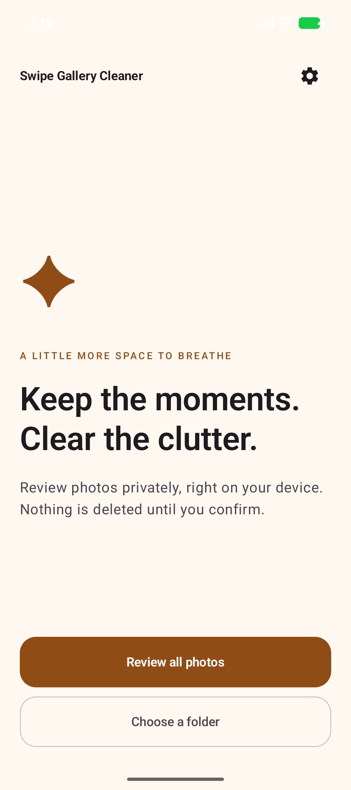
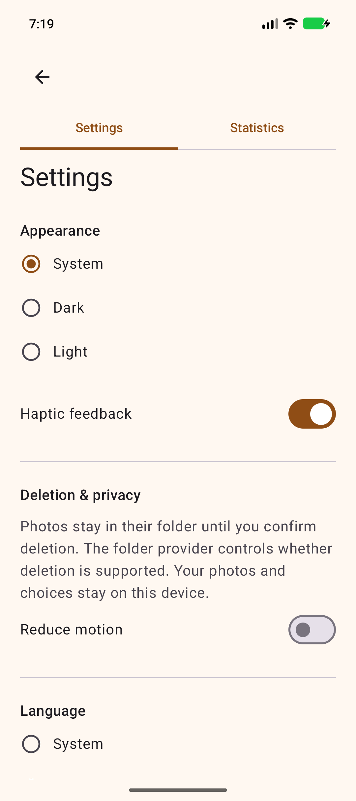
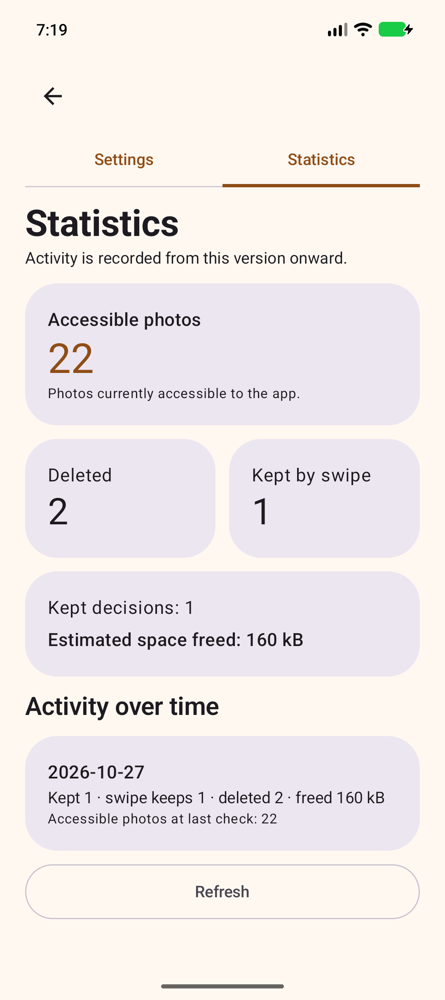

# Swipe Gallery Cleaner

Local photo review for Android 12+ by Miras. Open this folder in Android Studio, install Android SDK Platform 37, sync, then run. Build and test with `gradlew.bat assembleDebug testDebugUnitTest`. The debug APK is in `app/build/outputs/apk/debug/`. Material 3 Expressive uses Material 3 1.5.0-beta02; the app targets Android 16 while supporting Android 12 and newer.

Choose the device library or a Storage Access Framework folder. The library follows the permission granted, which can be limited to selected photos on Android 14+. Folder mode shows direct image files only; provider metadata, listing and deletion support vary. Folder dates use provider modification time; library dates use capture time where available and otherwise date added. Albums are based on the system media album name. Filter by album and date, and sort by date or size. Skip leaves a photo undecided.

Create named sessions per source; decisions, filters and individual-decision undo history persist across restarts. Similarity uses on-device thumbnail perceptual hashes and can have false positives or miss related images. Always compare photos yourself; similarity never deletes anything. No image contents are uploaded. Photos marked in the current session are listed for review, even if they are outside the current filter. The bulk mark button marks the current filtered set.

Library deletion requires the app confirmation and then Android system confirmation. It is processed in batches of up to 500; other marked photos remain pending. Folder deletion uses the document provider. Providers may refuse deletion or report missing metadata. Deletion can be permanent. Confirmed removals and their reported sizes are recorded locally as estimated freed space; zero or unavailable sizes can understate it. The statistics tab counts photos accessible to the app, not necessarily the entire device, and reports partial access when known. It records activity only from the version that added statistics, not historical activity from older builds. Daily accessible-photo snapshots are recorded when the statistics screen is opened or refreshed; days without a check have no snapshot. Keep and swipe figures are decision activity counts; undo reverses the corresponding recorded keep.

The app provides English, Russian, Kazakh, Spanish, French and German, along with system language, light/dark themes, haptics and reduced-motion settings. It stores identifiers and decisions in app-private preferences rather than image contents. Images are loaded with Coil. There is no network permission; the GitHub link opens in an external browser. Debug builds are signed with the local debug key and are for local testing, not store distribution.

## Screenshots

| Welcome | Settings | Statistics |
|:--:|:--:|:--:|
|  |  |  |

## Download

[Download the debug APK from Releases](https://github.com/mnerst1/swipe-gallery-cleaner/releases/tag/v2.0)

